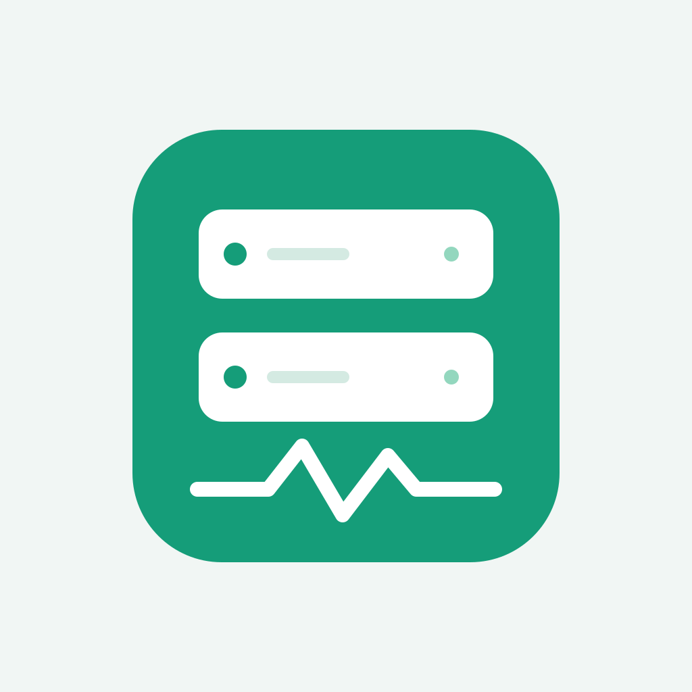
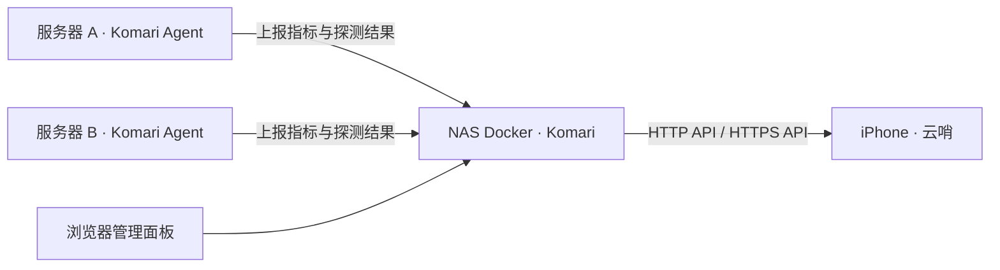

# 云哨 · Server Monitor for iOS

<p align="center"></p>

原生 iPhone 服务器监控客户端。NAS 的 Docker 运行开源 [Komari](https://github.com/komari-monitor/komari) 后端，每台服务器通过 Agent 上报数据，云哨读取 NAS 面板的数据并显示为紧凑卡片。

最低系统 **iOS 16.0**，面向 **iOS 16.6.1 + TrollStore（巨魔）** 安装。使用 SwiftUI、Swift Charts、URLSession 和 Keychain，无第三方 iOS 依赖。GitHub Actions 在 macOS 云端编译，输出可供 TrollStore 安装的 IPA。

## 数据从哪里来



App 不需要服务器 SSH 密码。服务器监控、历史记录和网络探测持续运行在 Agent 与 NAS 后端；手机在前台时读取数据。

## 功能

- 卡片显示地区、标签、在线状态、CPU、内存、磁盘和系统负载。
- 分段进度条，上传/下载速率、累计流量、运行时间、TCP/UDP 连接数。
- 展示后端配置的价格、到期时间和流量配额。
- 展示真实网络探测历史色块、延迟与失败情况；支持后端命名为电信、联通、移动的探测任务。
- CPU、内存、上下行速率的历史图表。
- 搜索名称、地区与标签，仅显示在线节点，下拉刷新。
- 配置面板地址、API Token、刷新间隔，并在保存前验证连接。
- Token 存在本机钥匙串，配置中不保存明文 Token。
- 显式演示模式，可在没有后端时查看界面；演示数据始终有标识。
- 遇到更新失败保留旧数据并提示；缺失指标显示 `—`。

## 获取 IPA 与巨魔安装

1. 打开 [GitHub Actions](https://github.com/ggb15075/server-monitor-ios/actions)。
2. 选择构建工作流，在 **Run workflow** 中触发构建，或使用最近一次成功构建。提交代码后也会按工作流配置自动构建。
3. 等待工作流显示绿色成功。进入该次运行，在页面底部 **Artifacts** 下载包含 IPA 的构建产物。下载 Artifact 通常需要登录 GitHub。
4. 解压下载的 ZIP，得到 `.ipa` 文件。把它保存到 iPhone 的“文件”App。
5. 在 TrollStore 中点 `+` → **Install IPA File**，选择 IPA；也可以从“文件”App 将 IPA 分享给 TrollStore。
6. 安装后打开“云哨”，添加 NAS 的 Komari 面板地址。

构建产物不包含 Apple 开发者证书，面向 TrollStore 安装，不走 App Store 或 TestFlight。工程最低版本与 TrollStore 支持范围是两项独立要求；[TrollStore 官方说明](https://github.com/opa334/TrollStore)列出的支持版本包含 iOS 16.6.1。IPA 的实际安装和运行仍需在目标手机上验证。

## NAS Docker 后端

使用仓库的 [`deploy/`](deploy/) 部署模板和 [NAS 部署说明](docs/DEPLOY-NAS.md)。后端采用 Komari 官方容器；监控数据需要映射到 NAS 的持久化目录，升级容器时保留该目录。不要把真实域名、Token、密码或服务器私钥提交到本仓库。

通用部署顺序：

1. 在 NAS 的 Docker/Container Manager 中导入 Compose 模板，设置数据目录和端口。
2. 启动 Komari，用浏览器打开 NAS 面板地址并完成初始管理配置。
3. 在面板添加被监控服务器，使用该版本面板生成的 Agent 安装命令在对应服务器执行。
4. 等待服务器上线，先在浏览器中确认 CPU、内存与网络指标正常。
5. 按需配置价格、到期日、流量额度以及网络探测任务。
6. 在云哨填入同一个面板首页地址。若面板设置为私有，填入后端生成的 API Token。

局域网地址示例：`http://192.168.1.10:25774`。外网访问可使用现有 VPN 或 HTTPS 反向代理；手机和远程服务器都必须能连接各自使用的 NAS 地址。直接填局域网 IP 不会让手机在蜂窝网络下自动连回家。

这里的端口和地址只是示例，按实际 Compose 配置填写。服务器安装 Agent 的凭据与 App 读取数据的凭据应分别管理。

## 连接设置

在 App 右上角打开连接设置：

| 设置 | 填写内容 |
| --- | --- |
| 面板名称 | 自定义显示名称，例如“家里的 NAS” |
| 面板地址 | Komari 面板首页完整地址，包含 `http://` 或 `https://` |
| API Token | 私有面板使用后端生成的 API Key；公开面板可留空 |
| 刷新间隔 | 5、10、15、30 或 60 秒 |

先点“测试连接”检查读取节点数量，再点“保存”。HTTPS 使用系统证书校验；自签名或过期证书需要在服务端正确配置，App 不提供跳过证书验证的开关。

## 指标含义与限制

- **三网探测**：由服务器 Agent 向配置的电信/联通/移动目标发起，不能将手机到服务器的连通性等同为三网质量。未配置任务时显示“尚未配置网络探测”。
- **丢包与失败**：ICMP 任务显示丢包；TCP/HTTP 等任务显示失败。色块来自实际历史记录，左旧右新，红色代表失败。
- **流量**：显示 Agent 上报的累计计数和后端额度，采用后端设置的 `sum/max/min/up/down` 口径。计数可能随探针或服务器重启、后端重置策略改变，不能默认当作自然月账单。当前 App 不自行估算运营商账单或流量重置日。
- **历史记录**：依赖后端实际保存的数据。新部署面板需要积累记录，没有数据时不会画虚构曲线。
- **后台行为**：手机 App 进入后台会停止轮询；NAS 与 Agent 继续采集。当前版本没有推送告警、桌面小组件、SSH 终端或后台常驻刷新。
- **面板版本**：数据层使用 Komari RPC2 `common:*` 接口，当前适配以仓库验证过的 Komari 版本与部署模板为准；不支持任意监控后端自动互换。升级后端前应检查 API 兼容性。
- **演示模式**：仅用于查看布局。切换到真实连接后才会显示自己的服务器数据。

## 源码与本地构建

需要 macOS 与带 iOS 16+ SDK 的 Xcode。工程由 XcodeGen 配置生成，具体 Xcode/runner 版本以 [`.github/workflows/`](.github/workflows/) 为准。

```sh
# 在仓库根目录执行；XcodeGen 可通过 Homebrew 安装
brew install xcodegen
swift scripts/generate_icon.swift
xcodegen generate
```

随后在 Xcode 打开生成的工程。真机 Release 构建、测试和 IPA 打包参数以工作流为准，避免本地命令与云编译配置不一致。

图标采用仓库内的 [SVG 源图](assets/logo.svg) 和 [原生 CoreGraphics 生成脚本](scripts/generate_icon.swift)，构建时生成所需 PNG 尺寸，不依赖在线图像服务。

```text
ServerMonitor/
  ServerMonitorApp.swift       应用入口
  Models/                      Komari DTO、统一模型、演示数据
  Services/                    网络请求、状态管理、钥匙串
  Views/                       首页、详情、连接设置与卡片组件
Tests/                         数据解析与指标计算测试
deploy/                        NAS Docker 部署模板
docs/                          部署与使用说明
scripts/                       构建辅助脚本
.github/workflows/             GitHub Actions 云编译
```

## 开源来源

此仓库提供原生 iOS 客户端，复用 Komari 的公开接口和官方后端/Agent，不是 Komari 官方发布的手机 App。

客户端源码采用 [MIT 许可证](LICENSE)。各上游项目保留自己的许可证与版权声明。

- [Komari](https://github.com/komari-monitor/komari)：MIT，监控后端。
- [Komari Agent](https://github.com/komari-monitor/komari-agent)：服务器采集端。
- [Komari API 文档](https://www.komari.wiki/dev/api)：接口与数据定义。
- [TrollStore](https://github.com/opa334/TrollStore)：IPA 安装方式与支持系统说明。

调研时也比较了 [ServerBox](https://github.com/lollipopkit/flutter_server_box) 和 [Nezha Mobile](https://github.com/hiDandelion/Nezha-Mobile)。本项目为适配 iOS 16 与紧凑卡片布局，采用独立 SwiftUI 界面，没有复制这些客户端的实现。
